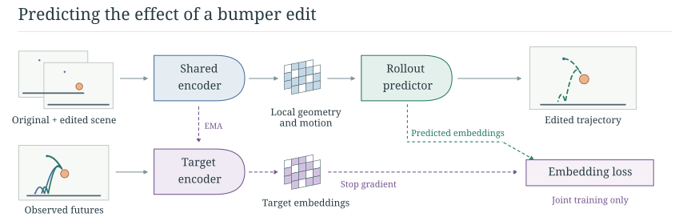
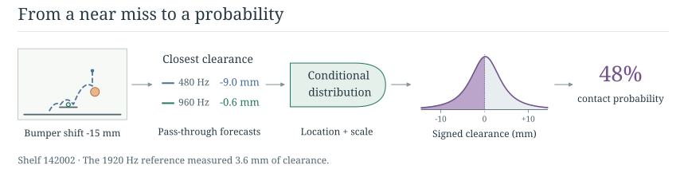

# Counterfactual Machine

Slide a bumper by a few millimeters. Will the ball still clip the ramp? Could that tiny move send it into a target, or make it miss a second ball entirely?

This is a local physics playground for trying those edits and a set of experiments about predicting their effects. You can move the bumper yourself, ask a model for a hint, and watch the simulator settle the question.

## Try it

From the repository root, with Python 3.12 or 3.13, [uv](https://docs.astral.sh/uv/) and Node.js installed:

```sh
uv sync --frozen --extra dev
npm ci --prefix ui
npm run build --prefix ui
uv run counterfactual serve --checkpoint artifacts/mechanics/swept-local-release/seed-0/model.pt --artifacts artifacts/mechanics/demo
```

Open **http://127.0.0.1:8000**. Drag the coral bumper and press **Drop ball**. **Give me a hint** scores up to 257 possible shifts and suggests the smallest one the model expects to work. Drop again to check its prediction. The trained hint model is included.

## What should a model learn from an edit?

In the one-ball experiments, the same ball starts from the same state in two scenes. Only the bumper moves. We compare predicting the edited trajectory directly with predicting a change relative to the original rollout. Each approach is trained with and without an extra task: predict an embedding of the future interaction. Only the training target sees the observed future. Its encoder is an exponential moving average (EMA) of the shared encoder.



Across 182 held-out tasks with a successful grid edit, the four learned variants repaired 83.5–87.2% of tasks on average across three seeds. The analytic control repaired 87.9%. The paired comparisons leave a learned advantage open. [Experiment results](artifacts/architecture/summary.json)

## When will two balls meet?

In the two-ball experiment, a striker bounces toward a receiver on a shelf. To describe a near miss, let the two predicted paths pass through each other and measure their closest surface-to-surface distance. Zero is the contact boundary. Two simulation step sizes give two estimates of that clearance; a fitted distribution turns their disagreement and the approach geometry into a probability.



The largest practical gain came from knowing **where to spend precision**. Computing just the first bumper impact on a finer clock recovered nine of ten recorded misses. On 48 fresh shelf layouts it reduced receiver trajectory error from **13.13 to 10.25 mm**, at roughly the original runtime. The uncertainty model also shows its limits: its 90% band covered the entire edit grid on **52 of 64** new layouts. [Methods, failures and reproduction commands](docs/relay-encounter.md)

Run the checks with `uv run pytest -q` and `npm test --prefix ui`. To redraw the two diagrams from the saved records, run `uv run python scripts/draw_overview.py`.
