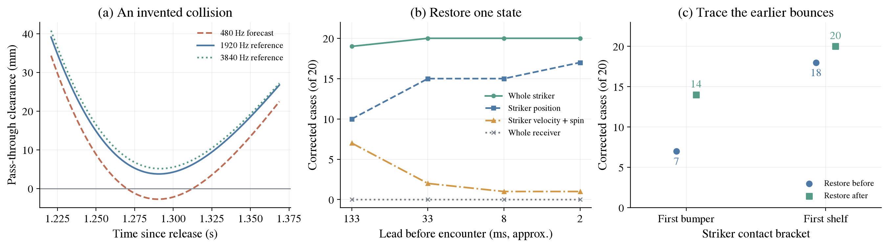
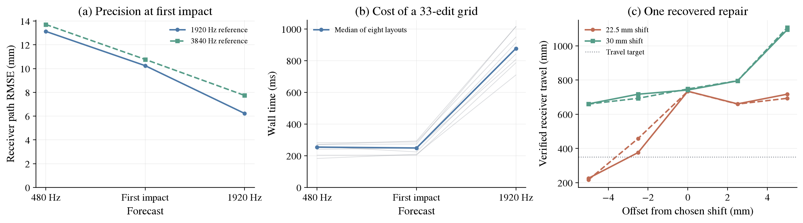
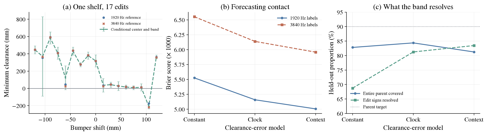

# Where the relay forecast loses the collision

A bumper shift can change where a striker meets a shelf and whether it ever reaches a second disk. On 32 held-out shelf layouts, the 480 Hz forecast missed ten contacts and invented ten others across 1,056 edits. Restoring the striker's position, velocity and spin about 33 ms before the encounter corrected **all 20**. Restoring the receiver corrected **zero**. Computing only the first bumper impact on a fine clock then recovered **nine of the ten missed contacts** from release, using only information available before the drop. The last miss involved a floor bounce followed by a shelf-end impact and repeated contact. [Restart records](../artifacts/relay-encounter/diagnosis.json) · [All 1,056 predictions at three precision settings](../artifacts/relay-encounter/clocks.json).



## How the twenty errors were identified

The diagnostic reran every archived edit with known receiver mass and the original 480 Hz forecast. Against 1920 Hz simulator callbacks there were 345 true hits, 691 true misses, ten missed and ten invented hits, with errors on 15 parents. The two reference clocks disagreed on three of all 1,056 labels, including one of the twenty cases. For each case we chose a different-parent true hit by encounter time and a different-parent near miss by clearance within a time window. Across 20 matched sets the 17 distinct hit controls and 11 distinct miss controls were sometimes reused. Median time differences were 4 ms and 60 ms. These are retrospective comparisons of correlated edits. [Matching protocol](../configs/relay-encounter.json) · [Parent-wise measurements](../artifacts/relay-encounter/parents).

The signed approach coordinate is the minimum distance between disk centers during a release with disk–disk impulses disabled, minus the sum of their radii. Negative values mean the disks' pass-through paths overlap. Both disks continue interacting with the environment. The first overlap can be measured even when the ordinary post-collision paths immediately separate. We also ran the **enabled** simulator independently to label first contact. Across the archive and the three statistical splits, the reference clearance sign matched the actual callback for all 3,895 edit cells at each reference clock. This coordinate answers whether the disks meet. Receiver travel and goal success still require the mechanical response. [Data generator](../src/counterfactual/relay_encounter.py) · [Split counts](../artifacts/relay-encounter/probability.json).

Each restart precedes the earlier of the first predicted and actual encounter and runs to the original two-second deadline. Lead times are rounded onto the 480 Hz grid. A forecast-state restart reproduced the free classification in every case. At the 33 ms checkpoint, position alone corrected 15/20 coarse-reference labels, velocity and spin alone corrected 2/20, and the whole striker corrected 20/20. Starting about 133 ms ahead still corrected 19/20. At the fine reference the whole striker gave 20/20 agreement at 33 ms, including one case already correct under that reference. About 8 ms before the encounter, the median striker position error was **169 mm** in the cases, **29 mm** in the matched hits and **11 mm** in the matched near misses. The median receiver discrepancy in the cases was 0.0018 mm. [Case and control kinematics](../artifacts/relay-encounter/diagnosis.json).

Restoring the striker immediately before its first bumper contact corrected seven of the twenty; restoring it after that contact corrected fourteen. Around the first shelf contact the counts were eighteen and twenty. Twelve of the twenty first shelf contacts were on the rounded end. These substitutions include all errors inherited up to the chosen tick. More than one substitution can recover a release, and the through-release experiment below tests what precision at the bumper alone can buy.

### The ten recorded misses

Clearances are in millimeters. The final column records whether computing only the first bumper impact at 1920 Hz recovered the **1920 Hz callback label**. Each row still uses coarse integration for the receiver, floor, shelf and disk–disk interaction. [All rows, including invented contacts and newly introduced errors](../artifacts/relay-encounter/clocks.json).

| Parent | Shift (mm) | 480 Hz forecast | 1920 Hz reference | 3840 Hz reference | Recovered |
|---|---:|---:|---:|---:|---|
| 123001 | +82.5 | +9.6 | −4.6 | −7.0 | Yes |
| 123002 | −112.5 | +14.8 | −164.3 | −247.1 | Yes |
| 123002 | −105.0 | +10.9 | −12.5 | −10.0 | Yes |
| 123003 | −15.0 | +3.1 | −4.0 | −3.4 | Yes |
| 123009 | −112.5 | +325.1 | −156.0 | −154.5 | Yes |
| 123012 | −37.5 | +450.7 | −11.9 | −2.9 | Yes |
| 123019 | +15.0 | +133.4 | −68.8 | −67.8 | No |
| 123025 | +90.0 | +1.2 | −8.8 | −12.0 | Yes |
| 123026 | −7.5 | +238.8 | −186.0 | −197.6 | Yes |
| 123029 | −45.0 | +174.1 | −3.5 | +14.0 | Yes, rate sensitive |

**The remaining miss locates the next test.** On parent 123019 at +15 mm, restoring even the exact outgoing bumper state still led to a miss under the subsequent coarse transitions. Restoring the striker before the floor bounce recovered the collision. The simulator next struck the rounded shelf end, with its center 127 mm beyond the planar span, then bounced along the face. About 9 ms before transfer, the forecast placed the disks 180 mm apart surface-to-surface and closing at 0.52 m/s; the reference had 7.5 mm and 0.85 m/s. Substituting only the striker position before the first shelf impact recovered the event. Immediately after that impact, substituting only its velocity and spin recovered it. This distinguishes an inaccurate approach to the shelf from the outgoing motion it produces. The test establishes sufficient repairs at particular times; it cannot assign a unique fraction of the error to each bounce. [Full event sequence and restart ticks](../artifacts/relay-encounter/diagnosis.json).

## Encoding an isolated bounce

For a resting disk dropped vertically, the height at tick $k$ on a clock with $h$ steps per second is $y_0-gk(k-1)/(2h^2)$, where $g$ is the magnitude of gravity. The edited circle fixes the entry height at its upper intersection with the vertical path. Solving for the first integer detection tick gives the **impact time and normal** without stepping through the fall on the fine clock. A friction-limited impulse yields the outgoing velocity and spin. At most four local fine ticks bring that state to the next coarse boundary. The other disk and all subsequent interactions use the ordinary 480 Hz solver. Moving releases, ambiguous geometry or an unsupported receiver use the ordinary solver. The audit and regression tests check the reconstructed state against fine integration. [Event encoder and decoder](../src/counterfactual/relay_launch.py) · [Follow-up protocol](../configs/relay-bumper-phase.json).

On the archived grid this change corrected nine missed and five invented transfers, and introduced five new disagreements. The resulting totals at 1920 Hz were **four missed and seven invented**, down from ten each. Full 1920 Hz integration agreed with all archived coarse-reference callbacks and disagreed with three fine-reference labels. A matching simulation clock is a strong analytic control. [Archived comparison](../artifacts/relay-encounter/clocks.json).

A separate confirmation cohort used 48 new shelf parents with 33 edits each. All 1,584 edits qualified for the isolated bumper calculation. Receiver errors below average the two-second path RMSE within each parent, then give equal weight to parents.

| Forecast | Receiver RMSE at 1920 Hz | Receiver RMSE at 3840 Hz | Invented / missed at 1920 Hz | Median time per 33 edits |
|---|---:|---:|---:|---:|
| Full 480 Hz | 13.13 mm | 13.72 mm | 26 / 15 | 255 ms |
| Fine first bumper impact | 10.25 mm | 10.78 mm | 7 / 5 | 249 ms |
| Full 1920 Hz | 6.23 mm | 7.75 mm | 0 / 0 | 878 ms |

The first-impact gain over 480 Hz was **2.88 mm** at the coarse reference (paired-parent 95% interval 1.71–4.13) and **2.94 mm** at the fine reference (1.16–4.59). The three methods used identical geometry, initial state, mass and material rules. Timing used sequential, rotated method order on the first eight confirmation parents. The thin traces show runtime variation across those layouts on one CPU. [Full-release confirmation](../artifacts/relay-encounter/handoff-confirmation.json) · [Timing samples and exact local tick counts](../artifacts/relay-encounter/clocks.json).



The improvement passed both predeclared bounds and opened 48 new decision parents. Among **34 initially failing goals**, all three methods proposed eight edits and all eight center verifications succeeded in each arm. Seven original proposals survived all ten offset checks; first-impact and full fine integration both achieved eight. The first-impact gain was one repair, 2.94 percentage points with paired-parent interval 0–8.82. For parent 146020 the original +22.5 mm shift failed under a −5 mm displacement error at both clocks. The +30 mm shift passed all ten checks and moved the receiver at least 660 mm against its 350 mm target (rounded). The solid and dashed curves in panel (c) are the coarse and fine references. Each planner had one center verification. The other nine checks were offline. [Decision records](../artifacts/relay-encounter/handoff-decisions.json).

A separate earlier comparison assessed full 1920 versus 480 Hz on 32 confirmation parents. Receiver RMSE fell by 4.86 mm (2.80–7.29) and 4.62 mm (2.67–6.90) at the two references. On another 48 decision parents there were 35 initial failures. Both solvers proposed nine edits; eight versus nine passed all ten checks. The two trials have distinct parents and different precision interventions. [Full-clock protocol](../configs/relay-encounter-decisions.json) · [Confirmation](../artifacts/relay-encounter/confirmation.json) · [Decisions](../artifacts/relay-encounter/decisions.json).

## A conditional distribution over closest approach

The statistical target is error in a forecast for a new shelf layout. The simulator itself is deterministic. The encoder uses two analytic pass-through trajectories, at 480 and 960 Hz, and zero future observations. The 960 Hz clearance provides a physical location. A learned, bounded multiple of the inter-clock difference corrects that location. A positive scale describes how much uncertainty remains. The contextual scale also reads time and speed at closest approach, elapsed time since the last striker contact onset, onset count, surface identity and distance to a shelf end. These scalar features preserve a horizontal reflection of the world.

We fit a Student-$t_2$ residual by likelihood on 64 training parents, giving the two reference clocks equal weight. It assigns heavier tails than a Gaussian and has an analytic CDF. The decoder evaluates that CDF at zero to obtain a contact probability. The constant-scale control uses the 960 Hz location alone. The clock-only control learns the location correction and conditions scale on clock disagreement. The contextual model adds seven geometric/history features to the log scale. All three use the same labels. The fixed extrapolation $2c_{960}-c_{480}$ and hard overlap rules provide additional analytic controls. [Implementation and fitted coefficients](../src/counterfactual/relay_probability.py) · [Protocol](../configs/relay-encounter.json).

For the two conditional models, let $c_h$ be the signed clearance on clock $h$, $x$ the standardized features and $s(x)>0$ the fitted scale. The location and contact-probability decoder are

$$
\mu=c_{960}+\beta(c_{960}-c_{480}), \qquad
P(\text{contact} \mid x)=\tfrac12\left(1-\frac{\mu}{\sqrt{\mu^2+2s(x)^2}}\right).
$$

Both the location and the scale stay in meters. Zero clearance has probability one half. The model can express confidence in a deep overlap and uncertainty about a grazing pass without learning the edit coordinate system again.

Calibration used 39 further independent parents, each with a fixed 17-edit grid. For a parent, take the largest absolute standardized residual across **all edits and both reference clocks**. The 36th of the 39 parent scores multiplies the predicted scale to form a simultaneous 90% split-conformal band. An edit has a resolved sign when its whole interval lies above or below zero. Under exchangeable parent draws this construction gives marginal whole-parent coverage over repeated calibration and test samples. One realized calibration split can under-cover. Probability accuracy uses the Brier score against actual contact callbacks. [Simultaneous conformal bands](https://arxiv.org/abs/2106.01792) · [Strictly proper scoring rules](https://doi.org/10.1198/016214506000001437).

| Model | Brier at 1920 / 3840 Hz (lower is better) | Entire test grids covered | Edit signs resolved | Median band width |
|---|---|---:|---:|---:|
| Constant scale | .00553 / .00655 | 53/64 | 748/1,088 | 282 mm |
| Clock-dependent | .00516 / .00614 | 54/64 | 884/1,088 | 110 mm |
| Clock and contact context | .00501 / .00596 | **52/64** | **908/1,088** | **86 mm** |

The contextual model called no resolved sign incorrectly at either reference in this test. Whole-grid coverage was **81.25%**, below the 90% target. A band can resolve every sign it declares and still miss a physical clearance value. The primary contextual-minus-clock Brier difference was −0.000153 (paired-parent 95% interval −0.000483 to +0.000133). The data support representing a contact boundary with uncertainty; they leave the incremental predictive value of these seven contextual features open. Hard 960 Hz overlap made eight coarse-reference errors; the learned probabilities thresholded at 0.5 made seven. Numerical-clock choice, probabilistic scoring and decision value are separately measured here. [Per-edit forecasts, scores and coverage](../artifacts/relay-encounter/probability.json).

The coverage failures point to a specific missing piece of state. In a retrospective check we took the edit and reference clock with the largest standardized clearance error on each test parent. The median discrepancy in **time of closest approach** was 219 ms for the 12 uncovered parents and 2 ms for the 52 covered parents. Seven of the twelve uncovered parents exceeded 100 ms, compared with seven of 52 covered parents. A large time shift is consistent with forecasting a different pass by the receiver. Testing that interpretation requires labels for which encounter supplied the minimum. [Worst edit and both times for each parent](../artifacts/relay-encounter/probability.json).



## Reproduce and build on this result

Run from the project root. The first command records 32 historical and 167 new training/calibration/test parents. The next commands fit, calibrate, diagnose and run the separate gated trials. Each simulation driver accepts `--output`; the figure command reads only the saved records. Each reported paired interval uses 2,000 bootstrap resamples of parents, retaining their edits and reference labels together. [Hashes and reproducibility checks](../artifacts/relay-encounter/validation.json).

```sh
.venv/bin/python -m counterfactual.relay_encounter
.venv/bin/python -m counterfactual.relay_restarts
.venv/bin/python -m counterfactual.relay_probability
.venv/bin/python -m counterfactual.relay_refinement
.venv/bin/python -m counterfactual.relay_refinement --handoff
.venv/bin/python -m counterfactual.relay_clock_audit
.venv/bin/python -m counterfactual.cli figures --output artifacts/relay-encounter
.venv/bin/python -m pytest -q
```

The next representation experiment is at the **finite shelf end**. Label face contact, endpoint contact and bypass on paired fine-reference releases. Encode incoming position relative to the edge, local contact normal, tangential speed and spin. Compare a single continuous residual with a distribution conditional on those three outcomes, using the same upstream first-bumper calculation and equal compute. A test on fresh layouts should measure mode probability, conditional outgoing motion, whole-release receiver error and worst-parent band failures. A contact-frame decoder has precedent in learned contact simulation. The advantage of conditioning on the shelf outcome in this task is a testable hypothesis. [ContactNets](https://proceedings.mlr.press/v155/pfrommer21a.html). The measured benefit so far belongs to analytic event-state encoding; a learned phase or response advantage remains open.
